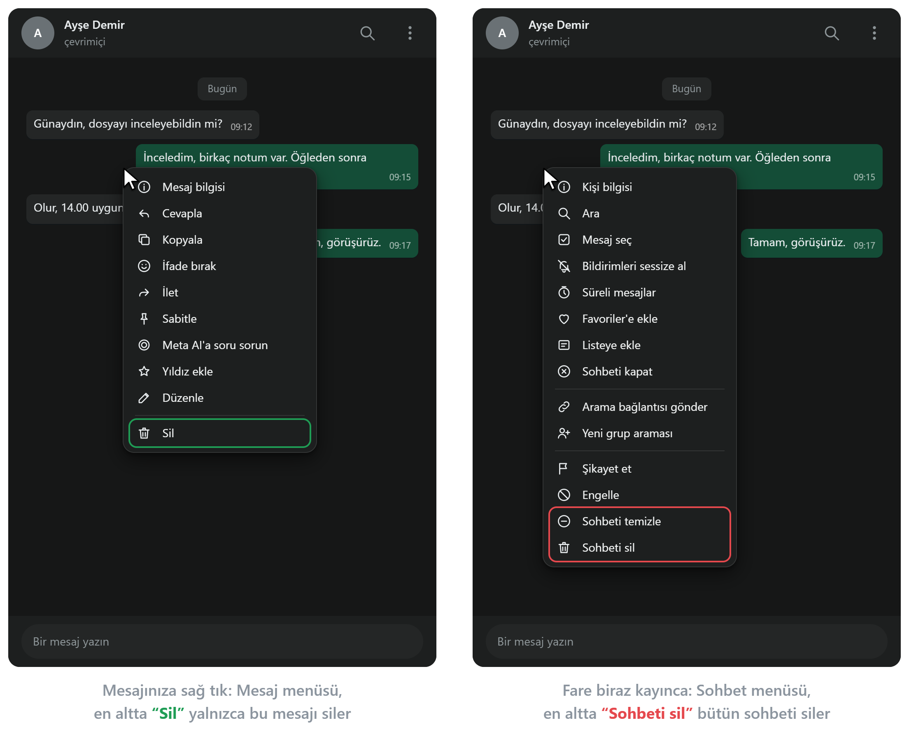
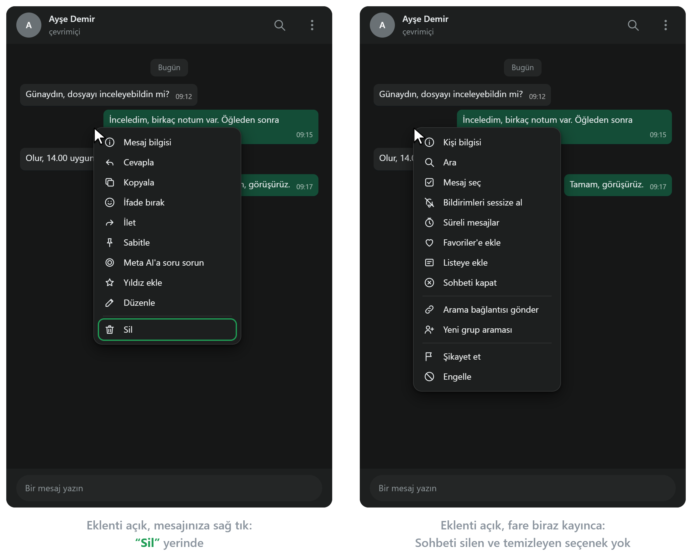

# WhatsApp Web için Sohbeti Sil Gizleyici

WhatsApp Web sohbet alanında sağ tıkla açılan menüdeki **“Sohbeti sil”** ve **“Sohbeti temizle”** seçeneklerini
gizleyerek tek bir mesaj silmek isterken tüm konuşmanın silinmesi ihtimali ortadan kaldıran Chrome eklentisi.

## Kurulum

1. Chrome Web Mağazası'nda **[WhatsApp Web için Sohbeti Sil Gizleyici](https://chromewebstore.google.com/detail/hgpmjganmgkdcelnajgibijnbbmodcjf)**'nin sayfasını açın.
2. **Chrome'a ekle** düğmesine basın, açılan pencerede **Uzantı ekle**'yi seçin.
3. Açık bir WhatsApp Web sekmeniz varsa **yenileyin (F5)**. Eklenti, kurulmadan önce açılmış sekmede çalışmaz.

Eklenti hiçbir veri tutmamak için herhangi bir anahtara (anahtarın açık kapalı olduğu verisini dahi tutmamak için) sahip
değildir, kurulunca hep çalışır. Eklentiyi geçici olarak kapatırsanız ya da yeniden açarsanız WhatsApp sekmesini
yenileyin. Yenileyene dek sekmede eski hâli sürer.

## Sorun: “Sil” ile “Sohbeti sil” neredeyse aynı yerde

WhatsApp Web'de çoğunlukla kendi gönderdiğiniz bir mesajı silersiniz. Mesaja sağ tıklarsınız, açılan **mesaj menüsünün**
en altında **“Sil”** vardır ve yalnızca o mesajı siler (soldaki görsel).

Fare biraz kayıp sağ tık mesajdan biraz uzağa, sohbetin boş yerine düşerse WhatsApp mesaj menüsünü değil, **sohbetin
menüsünü** açar (sağdaki görsel). Bu menü de neredeyse aynı yerde, farenin olduğu noktadan aşağı açılır. İki menü
birbirine çok benzer ve ikisinin de en altında çöp kutusu simgeli bir silme seçeneği vardır: Mesaj menüsünde “Sil”,
sohbet menüsünde **“Sohbeti sil”** (hemen üstünde de **“Sohbeti temizle”**). Alışkanlıkla en alttaki seçeneğe tıklayan
kişi tek bir mesaj yerine bütün sohbeti silebilir.

## Eklentiyle

Eklenti, sohbet alanında sağ tıkla açılan sohbet menüsündeki “Sohbeti temizle” ile “Sohbeti sil”i gizler. Mesaj menüsü
olduğu gibi kalır. Mesajın üstüne sağ tıklayınca “Sil” yine en altta durur. Yanlışlıkla sohbet menüsü açılırsa altta
sohbeti silen ya da temizleyen bir seçenek bulunmaz.

Eklenti, WhatsApp Web Türkçe ya da İngilizce kullanılırken çalışır. WhatsApp başka bir dilde kullanılıyorsa seçenekler
gizlenmez.

## Bir sohbeti isteyerek silmek

Eklenti yalnızca sağ tıkla açılan sohbet menüsünde gizler. Bir sohbeti bilerek silmek ya da temizlemek isterseniz iki
yol olduğu gibi durur:

- **Sohbetin üstündeki üç nokta menüsü:** Aynı sohbet menüsü bu düğmeyle açılınca “Sohbeti temizle” ve “Sohbeti sil”
  yerindedir.
- **Soldaki sohbet listesi:** Bir sohbete sağ tıklayınca ya da üzerine gelince çıkan okla açılan menüde iki seçenek de
  vardır.

## Gizlilik: Eklenti hiçbir veriyi okumaz, cihazda dahi veri saklamaz

Eklentide çalışan bir kod yoktur. WhatsApp sayfasına yalnızca seçenekleri gizleyen bir stil dosyası ekler. Eklenti
WhatsApp sayfasındaki hiçbir şeyi okumaz: Ne mesajlarınızı, ne kişilerinizi, ne telefon numaralarını, ne sohbet
adlarını. Hatta sağ tıkla açılan menüdeki seçeneklerin adlarını bile okumaz. Tıklamalarınızı ve bastığınız tuşları da
dinlemez. Hiçbir şey kaydetmez, hiçbir yere hiçbir veri göndermez. Eklentide herhangi bir ayar olmadığı için kendine ait
bir bilgi dahi saklamaz.

- **Hiçbir şey okumadan nasıl gizler:** Chrome, WhatsApp Web sayfası açılırken eklentinin stil dosyasındaki hazır
  kuralları sayfaya ekler. Kurallar kısaca şunu der: “Sağ tıkla açılan sohbet menüsünde adı ‘Sohbeti sil’ ve ‘Sohbeti
  temizle’ olan seçeneği gösterme.” Kuralları Chrome'un kendi çizim motoru uygular, eklentide çalışan bir kod yoktur.
- **Hiçbir şey saklamaz:** Eklentinin ayarı, açılır penceresi ve arka planda çalışan kodu yoktur. Chrome'un depolama
  (storage) iznini istemez, tarayıcıya hiçbir bilgi yazmaz.
- **Hiçbir şey dinlemez:** Sayfadaki tıklamaları, sağ tıkları ve tuşları dinlemez. Chrome'dan ya da başka bir yerden
  haber de beklemez. WhatsApp sayfasından bir şey almaz, başka bir yerle de haberleşmez.
- **İnternetle hiçbir bağı yoktur:** Stil dosyasında internetten bir şey yükleyen tek kural yoktur. Sunucusu, hesabı ya
  da kullanım istatistiği yoktur. Dışarıdan kod indirmez. Chrome'un eklenti kuralları (Manifest V3) buna izin vermez.
- **Nerede çalışır:** Yalnızca `web.whatsapp.com`'da çalışır, başka sitelere erişemez. Hiçbir izin istemez.

**Chrome ne gösterir?**

Bu eklenti sayfaya yalnızca stil kurallarını ekler, sayfadan hiçbir şey okumaz. Eklentinin **Ayrıntılar** sayfasında,
İzinler bölümünde “Bu uzantı herhangi bir özel izin gerektirmiyor” yazar. `web.whatsapp.com` ise ayrıca Site erişimi
bölümünde görünür.

**Kendiniz nasıl doğrularsınız?**

1. Eklentinin dosyaları bu depodadır. Eklentide JavaScript dosyası yoktur. WhatsApp sayfasına eklenen tek dosya,
   açıklamalı ve kısa bir stil dosyasıdır: `icerik.css`. Bir yazılımcı veya bir YZ modeli dosyayı birkaç dakikada
   okuyabilir.
2. `chrome://extensions` sayfasında eklentinin **Ayrıntılar** düğmesine basın. İzinler bölümünde “Bu uzantı herhangi bir
   özel izin gerektirmiyor” yazar.

## Otomatik denetimler

\

---

Soru ve geri bildirimler için: [x.com/CgrShn](https://x.com/CgrShn)

Lisans: AGPL-3.0. Ayrıntılar için [LICENSE](LICENSE) dosyasına bakınız.
